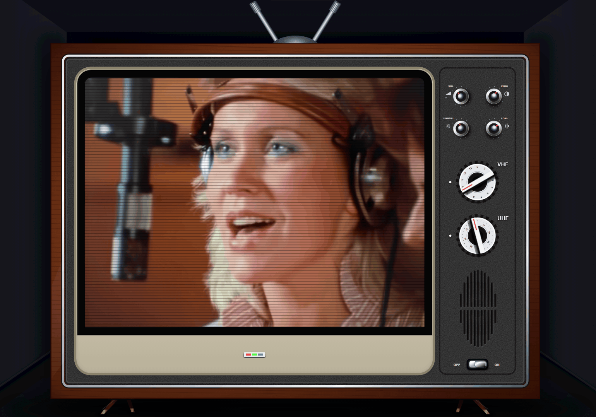

# Watch the YouTube video on "Retro TV"

Watch any YouTube video inside an authentic, dynamically scaling 80s CRT television.

## Overview
### Try nostalgia: [tvretro.github.io](https://tvretro.github.io/)

Retro TV turns your favorite YouTube videos into a nostalgic 80s viewing experience—just by tweaking the URL. Built purely with Vanilla JS and SVG, it automatically adapts the retro TV casing, curved CRT glass, and analog controls to fit any video ratio perfectly.

## Quick Usage & URL Trick

You can easily load any YouTube video by replacing `youtube.com` with `tvretro.github.io` directly in your browser's address bar:

  

* **Original YouTube URL:**  
  `https://www.youtube.com/watch?v=XEjLoHdbVeE`
* **Retro TV URL:**  
  [https://tvretro.github.io/watch?v=XEjLoHdbVeE](https://tvretro.github.io/watch?v=XEjLoHdbVeE)

*Note: You can also use the short URL format directly: `https://tvretro.github.io/XEjLoHdbVeE`*

#### Communication: https://www.linkedin.com/in/veserkan/
